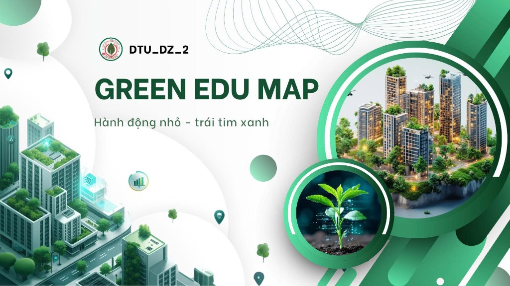

# 📝 Tổng quan về GreenEduMap



## 🎯 Mục tiêu dự án

**GreenEduMap** là một dự án mã nguồn mở do đội **DTU-DZ_2** đến từ **Đại học Duy Tân** phát triển để tham gia cuộc thi **Smart City 2026 • ISSCEI 2026** (nhóm lĩnh vực *Giám sát thông minh – Smart monitoring*), hướng tới Smart Campus và đô thị thích ứng, với mục tiêu:

🤝 **Kết nối người dân – trường học – chính quyền** bằng bản đồ tri thức.

🔍 **Minh bạch hóa dữ liệu đô thị** theo từng khu vực để cộng đồng dễ tiếp cận.

🤖 **Tối ưu hóa quy trình ra quyết định bằng AI** giúp gợi ý hành động xanh phù hợp từng khu vực.

🎓 **Thúc đẩy giáo dục bền vững** và khuyến khích cộng đồng cùng đóng góp, mở rộng.

Dự án tập trung hình thành một nền tảng toàn diện kết hợp AI, GIS, OpenData và dashboard thời gian thực để tạo nên hệ sinh thái đô thị minh bạch, xanh và có khả năng mở rộng cho nhiều địa phương.

## ✨ Modules chính

### 1. 📱 Module tương tác người dân & sinh viên

🌍 Xem dữ liệu môi trường realtime (chất lượng không khí PM2.5/AQI, nhiệt độ, mưa – ngập, giao thông)

🏫 Tìm kiếm trường học xanh, điểm tài nguyên xanh và khóa học bền vững (Green Skills)

📍 Gửi phản ánh cộng đồng 4 trạng thái (`đã gửi – tiếp nhận – đang xác minh – đã xử lý`) kèm ảnh GPS, chống trùng, xóa EXIF và che thông tin cá nhân

💡 Nhận cảnh báo theo vị trí (kèm nguồn, thời điểm, mức tin cậy) và gợi ý hành động xanh từ AI GreenBot

### 2. 🤖 Module phân tích AI & Dữ liệu

🧠 **AI GreenBot**: Diễn giải chỉ số môi trường bằng ngôn ngữ phổ thông, phân tích tương quan đa lớp

📈 Clustering khu vực (Xanh – Vàng – Đỏ) bằng K-Means dựa trên chỉ số môi trường

🔮 Dự báo xu hướng ô nhiễm, điểm nóng nhiệt và biến động mảng xanh

⭐ Minh bạch độ tin cậy: tách bạch dữ liệu đo thực tế, dữ liệu dự báo và phản ánh chưa xác minh

### 3. 🗺️ Module quản lý dữ liệu môi trường, giáo dục & WEFE

🌡️ Thu thập và quản lý 6 lớp dữ liệu không gian: không khí (OpenAQ/IoT), thời tiết – mưa (OpenWeather), điểm ngập, giao thông (OSM), cây xanh – tái chế – rác hữu cơ, trường học & cộng đồng

🏫 Quản lý trường học, khóa học xanh, điểm thu gom rác hữu cơ/vườn trường và tính toán Green Score

🗺️ Bản đồ 2D/3D realtime hiển thị dữ liệu môi trường – giáo dục – chuỗi liên kết **WEFE** (Nước – Năng lượng – Thực phẩm – Hệ sinh thái)

📊 Dashboard trực quan cho chính quyền và trường học

### 4. 📊 Module quản trị hệ thống & OpenData

📉 Dashboard tổng quan và báo cáo KPI cho cơ quan quản lý

🔗 API mở theo chuẩn NGSI-LD và Linked Open Data

📥 Export dữ liệu đa định dạng (JSON, CSV, GeoJSON, RDF)

⚙️ Phân quyền, quản lý người dùng và giám sát hệ thống

## 🏗️ Kiến trúc hệ thống

Hệ thống được thiết kế theo kiến trúc Microservices, đảm bảo khả năng mở rộng và xử lý dữ liệu lớn:

- **Frontend**: Next.js 14 (Web), React Native (Mobile)
- **Backend**: Python, FastAPI (Python cho AI)
- **Database**: PostgreSQL + PostGIS, MongoDB, Redis
- **Semantic**: FiWARE Orion-LD cho NGSI-LD
- **Infrastructure**: Docker, Kubernetes

Xem chi tiết tại [Kiến trúc hệ thống](Architecture.md).

## 🔗 Linked Open Data

GreenEduMap tuân thủ chuẩn **NGSI-LD** (ETSI GS CIM 009) để chia sẻ dữ liệu đô thị xanh theo hướng Linked Open Data.

Xem chi tiết tại [OpenData Service](Services/OpenDataService/Readme.md).

## 👥 Team Members & Giảng viên hướng dẫn

| Role | Name | Email |
| --------- | ------------------------ | --------------------------------------------------------------------- |
| Advisor | **Th.S Trần Kim Sanh** | [trankimsanh@dtu.edu.vn](mailto:trankimsanh@dtu.edu.vn) |
| Leader / Developer | **Trần Xuân Trường** | [xuantruong081205@gmail.com](mailto:xuantruong081205@gmail.com) |
| Developer | **Hồ Dương Quốc Huy** | [huyho2782005@gmail.com](mailto:huyho2782005@gmail.com) |
| Developer | **Võ Thị Thái Ngọc** | [vothithaingoc207@gmail.com](mailto:vothithaingoc207@gmail.com) |

## 🤝 Đóng góp

```bash
# 1. Fork repository
git clone https://github.com/HoDuongQuocHuy278/GreenEduMap-DTUDZ-documents.git
cd GreenEduMap-DTUDZ-documents

# 2. Create feature branch
git checkout -b feat/my-feature

# 3. Commit changes
git commit -m "feat: add new feature"

# 4. Create Pull Request
git push origin feat/my-feature
```

## 📝 License

Dự án này được phân phối dưới [GNU General Public License v3.0](https://github.com/HoDuongQuocHuy278/GreenEduMap-DTUDZ-documents/blob/main/LICENSE). Xem file `LICENSE` để biết thêm chi tiết.

© 2026 GreenEduMap – Được phát triển với ❤️ bởi Nhóm DTU-DZ_2
