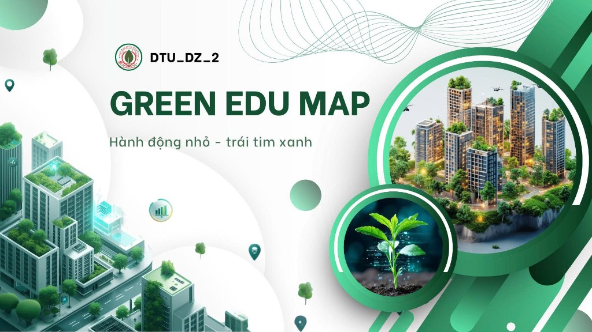
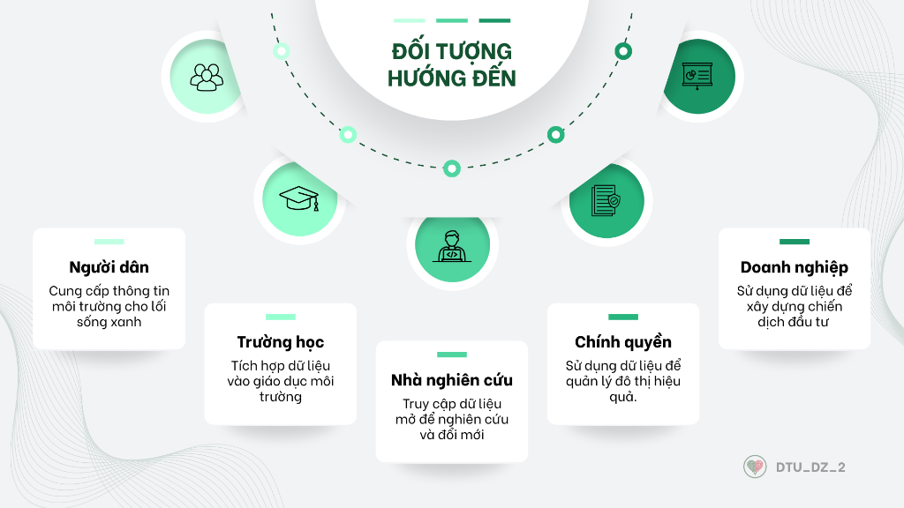

# 🌿 GreenEduMap — Dữ liệu mở dẫn lối đô thị xanh

> _"Xanh hơn mỗi ngày – Dữ liệu vì cộng đồng xanh 🌍"_

**GreenEduMap**! Đây là dự án mã nguồn mở được xây dựng với mong muốn giúp đô thị trở nên xanh và bền vững hơn. GreenEduMap là nền tảng kết nối người dân, trường học và chính quyền thông qua dữ liệu mở về môi trường và giáo dục, hỗ trợ ra quyết định thông minh nhờ sự hỗ trợ của AI.

---

## 🤔 Tại sao lại có dự án này?

Chúng ta đều thấy các đô thị đang phát triển nhanh chóng, và các vấn đề như ô nhiễm không khí, hiệu ứng đảo nhiệt đô thị, thiếu cây xanh hay chất lượng giáo dục môi trường đang trở nên nghiêm trọng hơn. Tuy nhiên:

- Dữ liệu môi trường, giáo dục và năng lượng tồn tại rời rạc ở nhiều nguồn khác nhau, khó truy cập và thiếu chuẩn hóa.
- Chính quyền thiếu công cụ phân tích tổng hợp để ra quyết định quy hoạch cây xanh, năng lượng tái tạo hay giáo dục bền vững dựa trên dữ liệu khoa học.
- Người dân và trường học không có nguồn thông tin đáng tin cậy, trực quan về chất lượng môi trường và các hoạt động xanh quanh khu vực mình.

GreenEduMap ra đời để giải quyết những vấn đề đó, hướng tới một đô thị minh bạch hơn, thông minh hơn và bền vững hơn thông qua dữ liệu mở và giáo dục xanh.

---

## 👥 Dự án này dành cho ai?

1. **Người dân & Sinh viên:** Xem chất lượng sống, nhận cảnh báo ô nhiễm, nắng nóng, mưa ngập theo khu vực/tuyến đi và nhận gợi ý hành động xanh, gửi phản ánh hiện trường kèm ảnh GPS.
2. **Chính quyền:** Ra quyết định dựa trên dữ liệu, sử dụng dữ liệu để quản lý đô thị hiệu quả.
3. **Trường học:** Triển khai giáo dục xanh (Green Skills), tích hợp dữ liệu vào giáo dục môi trường.
4. **Tổ chức môi trường:** Sử dụng dữ liệu cho vận động và giám sát, xây dựng chiến dịch truyền thông dựa trên dữ liệu thật.
5. **Nhà nghiên cứu:** Truy cập dữ liệu mở chuẩn hóa để nghiên cứu và đổi mới, xây dựng mô hình AI/ML.

---

## ✨ Có gì đặc biệt?

- **AI GreenBot:** Tự động phân tích dữ liệu để đọc hiểu dữ liệu môi trường – giáo dục, phát hiện mẫu bất thường và gợi ý các hành động xanh cụ thể cho từng khu vực.
- **Bản đồ Realtime:** Người dùng có thể xem nhanh bức tranh "sức khỏe đô thị" trên bản đồ 3D, cập nhật theo thời gian thực với nhiều lớp dữ liệu.
- **Đa nền tảng:** Web Dashboard cho chính quyền/trường học và Mobile App cho người dân.
- **Dữ liệu mở & tương thích quốc tế:** Dữ liệu giúp dễ dàng chia sẻ, tái sử dụng và phục vụ nghiên cứu theo chuẩn NGSI-LD và Linked Open Data.

---

## 🛠️ Công nghệ sử dụng

Hệ thống được xây dựng dựa trên các công nghệ hiện đại:

| Thành phần         | Công nghệ sử dụng                                       |
| ------------------ | ------------------------------------------------------- |
| **Web App**        | Next.js 14                                              |
| **Mobile App**     | React Native (iOS & Android)                            |
| **Backend Core**   | FastAPI (Python), Redis (Cache), JWT                    |
| **AI/ML Service**  | Python 3.11, scikit-learn, pandas, aio-pika             |
| **Message Broker** | RabbitMQ, MQTT (EMQX)                                   |
| **Database**       | PostgreSQL + PostGIS, MongoDB                           |
| **Semantic Layer** | FiWARE Orion-LD (NGSI-LD)                               |
| **Real-time**      | WebSocket                                               |

---

## 🚀 Cách hoạt động

Quy trình đơn giản như sau:

1. **Hệ thống thu thập dữ liệu** 🌐 → ETL tự động lấy dữ liệu từ OpenAQ, OpenWeather, Sentinel, OpenStreetMap → Làm sạch & chuẩn hóa.
2. **AI phân tích & xử lý** 🤖 → Phân tích tương quan môi trường ↔ giáo dục, clustering khu vực, gợi ý hành động xanh → Cập nhật NGSI-LD Entities.
3. **Người dùng** 📱 → Xem bản đồ 3D, dashboard, hoặc gửi phản hồi qua App.
4. **Hiển thị** 🗺️ → Bản đồ 3D realtime, dashboard, thống kê → Người dùng nhận gợi ý xanh.

---

## 🌱 Hướng phát triển

Dự án hướng tới xây dựng hệ sinh thái đô thị xanh thông minh, không chỉ dừng lại ở hiển thị dữ liệu mà còn mở rộng khả năng dự báo, tự động hóa và kết nối cộng đồng.

### 🌐 Mở rộng & Kết nối

- Triển khai đa đô thị: Mở rộng GreenEduMap cho nhiều thành phố, hỗ trợ đa ngôn ngữ.
- Bản đồ 3D thời gian thực: Hiển thị lớp dữ liệu môi trường – giáo dục – năng lượng với vùng cảnh báo "điểm nóng".
- Nền tảng cộng đồng xanh: Kết nối người dân – trường học – doanh nghiệp thông qua dữ liệu mở và hoạt động xanh.

### 🧠 Nâng cấp AI & Dữ liệu

- Dự báo xu hướng đô thị: Phân tích dữ liệu lịch sử để dự đoán ô nhiễm không khí, nhiệt độ và biến động mảng xanh.
- AI GreenBot nâng cao: Học từ dữ liệu người dùng đóng góp và cảm biến IoT môi trường.
- Phân tích hình ảnh vệ tinh: Tự động nhận diện thay đổi cây xanh, bê tông hóa từ ảnh Sentinel.

### 🔗 Dữ liệu mở & Minh bạch

- Chuẩn hóa dữ liệu mở: Áp dụng NGSI-LD, RDF/JSON-LD để chia sẻ dữ liệu môi trường và giáo dục.
- API mở: Cho phép sinh viên, nhà nghiên cứu và startup phát triển các ứng dụng xanh trên nền tảng.
- Quản lý chất lượng dữ liệu: Theo dõi nguồn gốc dữ liệu (data lineage) và độ tin cậy.

---

## 📄 Giấy Phép

Dự án này được phân phối dưới [GNU General Public License v3.0](../LICENSE). Xem file `LICENSE` để biết thêm chi tiết.

## 👨‍🏫 Giảng viên hướng dẫn

- **Th.S Trần Kim Sanh**: trankimsanh@dtu.edu.vn

## 📞 Liên hệ Team DTU-DZ2

Nếu cần trao đổi gì thêm, vui lòng liên hệ:

- **Trần Xuân Trường** *(Trưởng nhóm)*: xuantruong081205@gmail.com
- **Hồ Dương Quốc Huy**: huyho2782005@gmail.com
- **Võ Thị Thái Ngọc**: vothithaingoc207@gmail.com

---

© 2026 **GreenEduMap** – Code with ❤️ by DTU-DZ_2 Team
